# Linux Server Hardening & Operations Lab

Dự án thực hành ghi lại toàn bộ quá trình xây dựng một máy chủ Linux trên **AWS EC2** từ đầu: hardening bảo mật, triển khai ứng dụng web bằng Docker, quản lý lưu trữ bằng LVM và xây dựng hệ thống vận hành tự động (backup, giám sát, phục hồi dữ liệu).

---

## Mục lục

- [Tổng quan](#tổng-quan)
- [Công nghệ sử dụng](#công-nghệ-sử-dụng)
- [Cấu trúc thư mục](#cấu-trúc-thư-mục)
- [Kiến trúc hệ thống](#kiến-trúc-hệ-thống)
- [Hardening máy chủ](#hardening-máy-chủ)
- [Quản lý lưu trữ với LVM](#quản-lý-lưu-trữ-với-lvm)
- [Docker Stack](#docker-stack)
- [Giám sát và tự động hóa](#giám-sát-và-tự-động-hóa)
- [Backup và phục hồi](#backup-và-phục-hồi)
- [Hướng dẫn triển khai](#hướng-dẫn-triển-khai)
- [Tham chiếu cấu hình](#tham-chiếu-cấu-hình)

---

## Tổng quan

Dự án gồm 4 phần chính:

1. **Hardening máy chủ**: bảo mật EC2 Ubuntu mặc định bằng UFW, Fail2Ban, SSH hardening và đánh giá bằng Lynis.
2. **Quản lý lưu trữ**: tổ chức đĩa và phân vùng dữ liệu bằng LVM.
3. **Triển khai ứng dụng bằng Docker**: stack Nginx + PHP-FPM + MariaDB chạy trên Docker Compose, áp dụng các biện pháp bảo mật ở cấp container.
4. **Tự động hóa vận hành**: backup, health check và giám sát disk bằng các script Bash chạy theo Systemd timer, kèm quy trình phục hồi database.

---

## Công nghệ sử dụng

| Thành phần | Công nghệ |
|---|---|
| Cloud | AWS EC2 (Ubuntu 22.04) |
| Web server | Nginx 1.27 Alpine |
| Runtime ứng dụng | PHP 8.3-FPM Alpine |
| Cơ sở dữ liệu | MariaDB 11.4 |
| Container hóa | Docker Compose v2 |
| Lưu trữ | LVM |
| Tự động hóa | Bash + Systemd timer |
| Bảo mật | UFW, Fail2Ban, SSH hardening, Lynis |

---

## Cấu trúc thư mục

```
.
├── config/
│   └── lab-web-monitor.conf        # Cấu hình chung cho các script giám sát
│
├── docker/
│   ├── docker-compose.yml          # Định nghĩa toàn bộ Docker stack
│   ├── nginx/
│   │   └── default.conf            # Virtual host Nginx
│   ├── php/
│   │   └── Dockerfile              # Image PHP 8.3-FPM + extension mysqli
│   └── mariadb/
│       └── custom.cnf              # Cấu hình tùy chỉnh MariaDB
│
├── scripts/
│   ├── backup.sh                   # Backup source code và database
│   ├── server_healthcheck.sh       # Kiểm tra RAM, disk, Docker và HTTP
│   ├── disk_monitor.sh             # Giám sát dung lượng disk theo ngưỡng
│   └── recovery.sh                 # Phục hồi database từ file backup
│
├── systemd/
│   ├── backup.service / .timer             # Backup mỗi ngày lúc 02:00
│   ├── server-healthcheck.service / .timer # Health check mỗi 5 phút
│   └── disk-monitor.service / .timer       # Giám sát disk mỗi 15 phút
│
└── docs/
    └── images/                     # Ảnh chụp màn hình và bằng chứng thực hiện
```

---

## Kiến trúc hệ thống

```
Internet
    |
    v
[ AWS Security Group ]  -- Cho phép cổng 22 (SSH), 80 (HTTP)
    |
    v
[ EC2 Instance ]
    |-- UFW Firewall
    |-- Fail2Ban (chống brute-force SSH)
    |
    v
[ Docker Compose ]
    |
    |-- nginx   (mạng frontend)
    |       |-- lắng nghe cổng 80, expose ra host
    |       |-- fastcgi_pass --> php:9000
    |
    |-- php     (mạng frontend + backend)
    |       |-- kết nối --> mariadb:3306
    |
    |-- mariadb (mạng backend, nội bộ)
            |-- KHÔNG expose cổng ra host
            |-- dữ liệu lưu tại /srv/data/mariadb (bind mount)
```

**Phân tách mạng**

- `frontend`: Nginx và PHP giao tiếp với nhau.
- `backend`: chỉ có PHP và MariaDB. MariaDB không expose cổng ra host nên không thể bị truy cập trực tiếp từ bên ngoài.

Trạng thái các container sau khi triển khai:

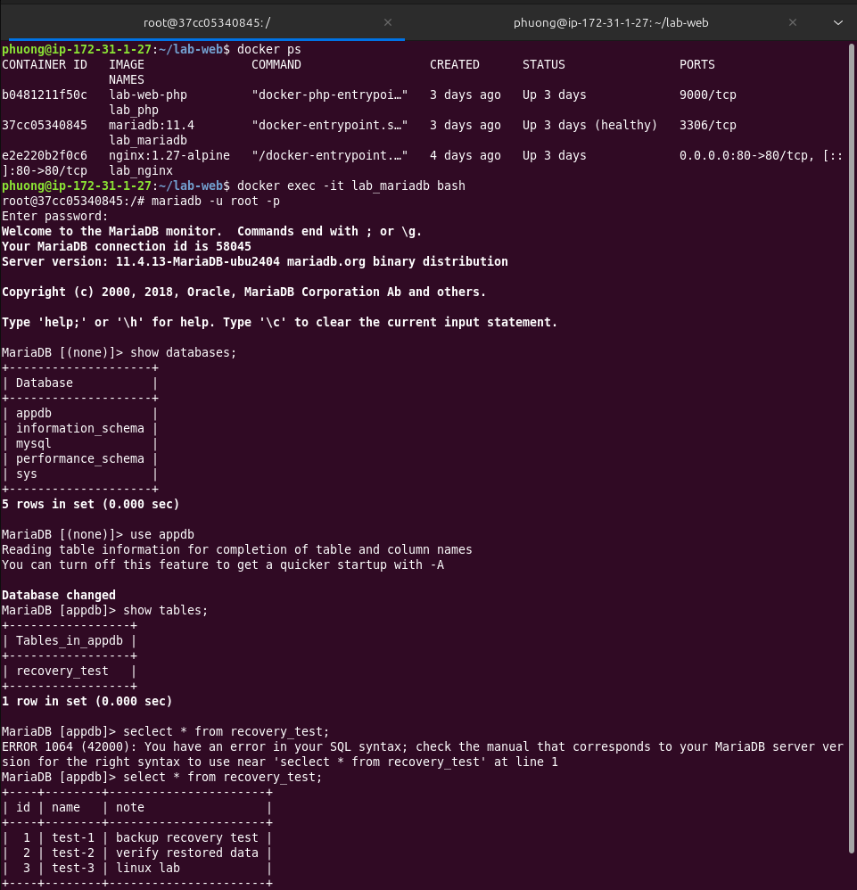

---

## Hardening máy chủ

Các lớp bảo vệ được áp dụng trên EC2:

| Lớp | Công cụ | Mục đích |
|---|---|---|
| Mạng (cloud) | AWS Security Group | Chỉ mở cổng 22 và 80 |
| Mạng (host) | UFW | Firewall cấp host, chặn mọi cổng không cần thiết |
| Chống brute-force | Fail2Ban | Tự động chặn IP đăng nhập SSH sai nhiều lần |
| Truy cập | SSH hardening | Giảm bề mặt tấn công của dịch vụ SSH |
| Đánh giá | Lynis | Audit và chấm điểm hardening của hệ thống |

### UFW

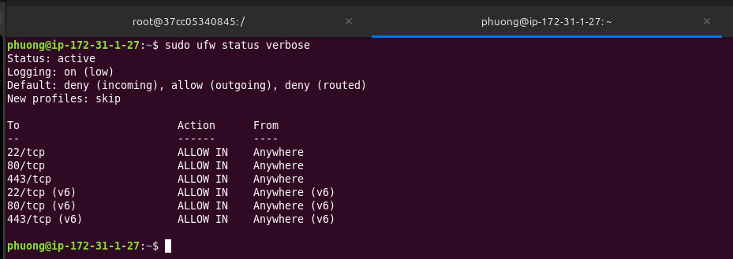

### Fail2Ban

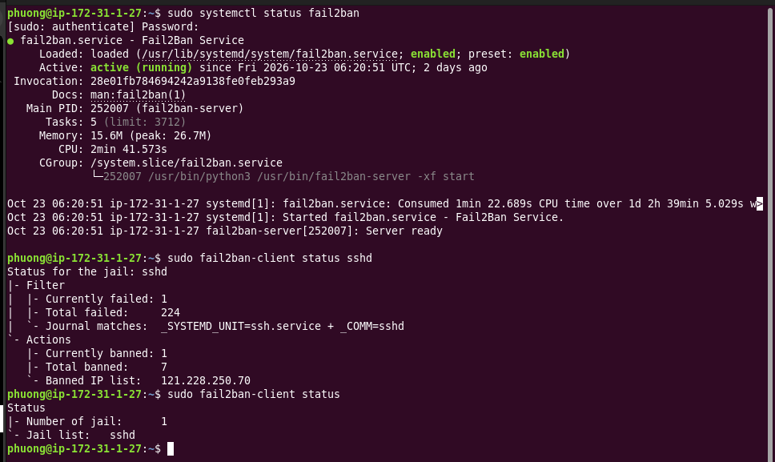

### Đánh giá bằng Lynis

Chạy Lynis trước và sau khi hardening để so sánh **Hardening index**.

Trước khi hardening:

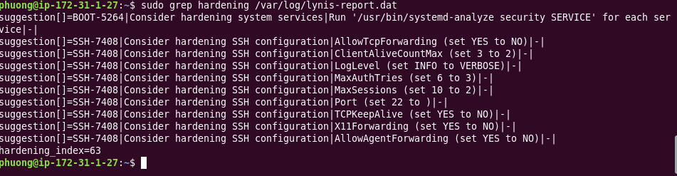

Sau khi hardening:

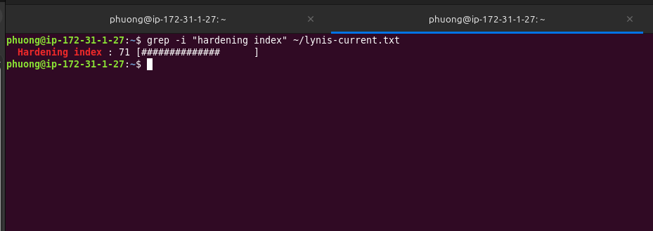

---

## Quản lý lưu trữ với LVM

Dữ liệu ứng dụng và backup được đặt dưới `/srv/data`, tách khỏi phân vùng hệ thống để dễ mở rộng và tránh làm đầy ổ root.

Trạng thái đĩa và phân vùng trước khi cấu hình (`lsblk`):

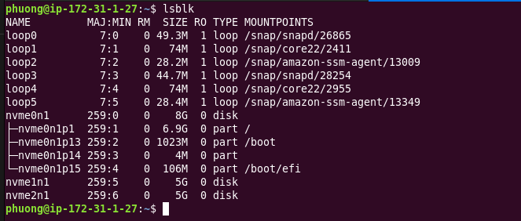

Cấu hình LVM sau khi thực hiện:

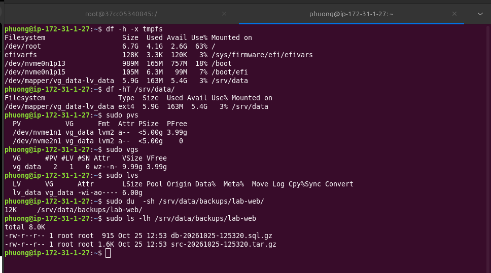

---

## Docker Stack

### Nginx (`docker/nginx/default.conf`)

Phục vụ file tĩnh và chuyển tiếp request `.php` sang PHP-FPM qua FastCGI.

```nginx
server {
    listen 80;
    server_name _;
    server_tokens off;

    root /var/www/html;
    index index.php index.html;

    add_header X-Frame-Options "SAMEORIGIN" always;
    add_header X-Content-Type-Options "nosniff" always;
    add_header Referrer-Policy "strict-origin-when-cross-origin" always;
    add_header Content-Security-Policy "default-src 'self'" always;
    add_header Permissions-Policy "geolocation=(), microphone=(), camera=()" always;

    location / {
        try_files $uri $uri/ =404;
    }

    location ~ \.php$ {
        include fastcgi_params;
        fastcgi_pass php:9000;
        fastcgi_param SCRIPT_FILENAME $document_root$fastcgi_script_name;
    }

    location ~ /\. {
        deny all;
    }
}
```

| Khối | Vai trò |
|---|---|
| `server_name _` | Server mặc định, nhận mọi request đến cổng 80 bất kể tên miền |
| `server_tokens off` | Ẩn phiên bản Nginx khỏi response header và trang lỗi |
| `location /` | Phục vụ file tĩnh, trả `404` nếu file không tồn tại |
| `location ~ \.php$` | Chuyển request `.php` sang container `php` cổng 9000 qua FastCGI |
| `location ~ /\.` | Chặn mọi dotfile như `.env`, `.git` bằng `deny all` |

Các security header (gắn `always` nên áp dụng cả với response lỗi):

| Header | Giá trị | Mục đích |
|---|---|---|
| `X-Frame-Options` | `SAMEORIGIN` | Chống clickjacking |
| `X-Content-Type-Options` | `nosniff` | Chống MIME sniffing |
| `Content-Security-Policy` | `default-src 'self'` | Chặn tải tài nguyên từ bên ngoài |
| `Referrer-Policy` | `strict-origin-when-cross-origin` | Kiểm soát thông tin referrer |
| `Permissions-Policy` | tắt geolocation, microphone, camera | Tắt các API nhạy cảm |

### PHP (`docker/php/Dockerfile`)

```dockerfile
FROM php:8.3-fpm-alpine
RUN docker-php-ext-install mysqli
USER www-data
```

Container chạy bằng user `www-data` (không phải root) và chỉ cài extension `mysqli`, không cài thêm thành phần nào không cần thiết.

### MariaDB (`docker/mariadb/custom.cnf`)

```ini
[mysqld]
skip-name-resolve        # Bỏ qua DNS lookup khi có kết nối vào, nhanh hơn trong môi trường Docker
bind-address = 0.0.0.0   # Cho phép kết nối từ các container khác trong cùng mạng Docker
```

- Cổng 3306 **không được expose ra host**. MariaDB chỉ nhận kết nối từ container PHP qua mạng nội bộ `backend`.
- Dữ liệu lưu tại `/srv/data/mariadb` (bind mount), nên không bị mất khi chạy `docker compose down`.

### Giới hạn tài nguyên container

| Container | CPU | RAM |
|---|---|---|
| nginx | 0.5 core | 256 MB |
| php | 0.5 core | 256 MB |
| mariadb | 1.0 core | 512 MB |

---

## Giám sát và tự động hóa

Tất cả script giám sát đọc cấu hình từ `/etc/lab-web-monitor.conf`.

### Lịch chạy Systemd timer

| Timer | Lịch chạy |
|---|---|
| `backup.timer` | Mỗi ngày lúc 02:00 |
| `server-healthcheck.timer` | Mỗi 5 phút (lần đầu sau 2 phút kể từ khi boot) |
| `disk-monitor.timer` | Mỗi 15 phút (lần đầu sau 3 phút kể từ khi boot) |

Kiểm tra trạng thái và log:

```bash
systemctl list-timers
journalctl -u server-healthcheck.service -f
journalctl -u disk-monitor.service -f
journalctl -u backup.service -f
```

### `server_healthcheck.sh`

Kiểm tra:

- Dung lượng RAM hiện tại (ghi log qua `free -h`).
- Dung lượng disk tại `PROJECT_DIR` theo ngưỡng `DISK_WARN` và `DISK_CRIT`.
- Tất cả service trong Docker Compose có đang chạy không.
- HTTP endpoint (`HTTP_URL`) có trả về mã `2xx` không.

Log: `/var/log/lab-web/server-healthcheck.log`

Mã thoát: `0` bình thường, `1` có cảnh báo, `2` có lỗi nghiêm trọng.

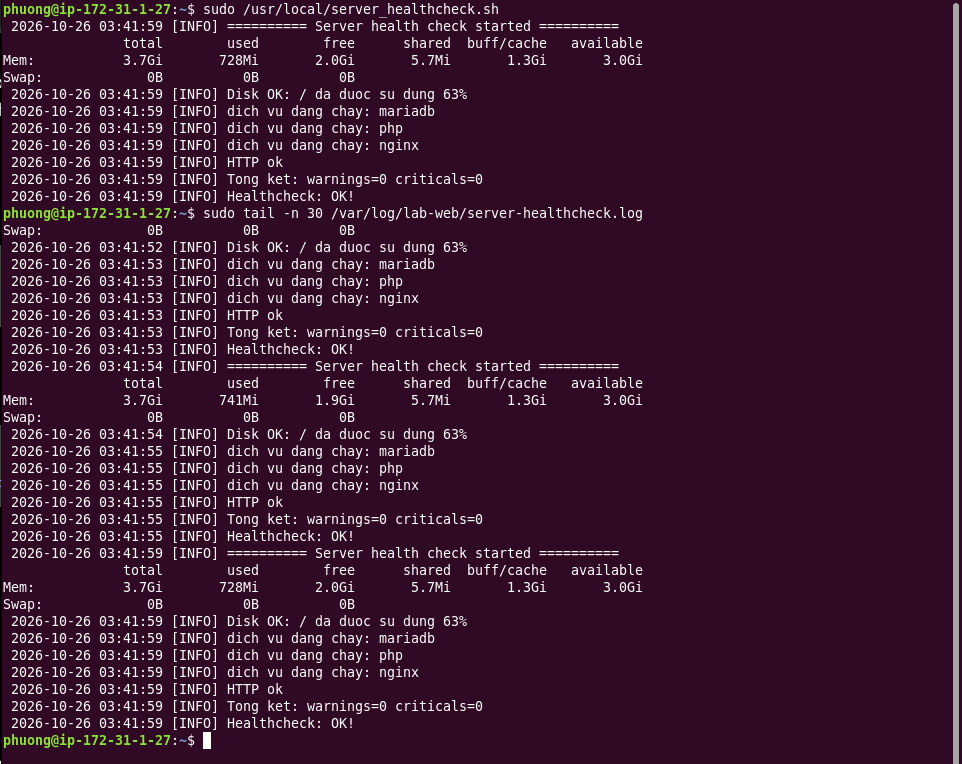

### `disk_monitor.sh`

Kiểm tra tất cả filesystem đang mount, bỏ qua `tmpfs`, `devtmpfs`, `overlay`, `squashfs`.

Có thể ghi đè ngưỡng cảnh báo tạm thời mà không cần sửa file cấu hình:

```bash
DISK_WARN_OVERRIDE=70 DISK_CRIT_OVERRIDE=85 ./scripts/disk_monitor.sh
```

Log: `/home/phuong/lab-web/logs/disk-monitor.log`

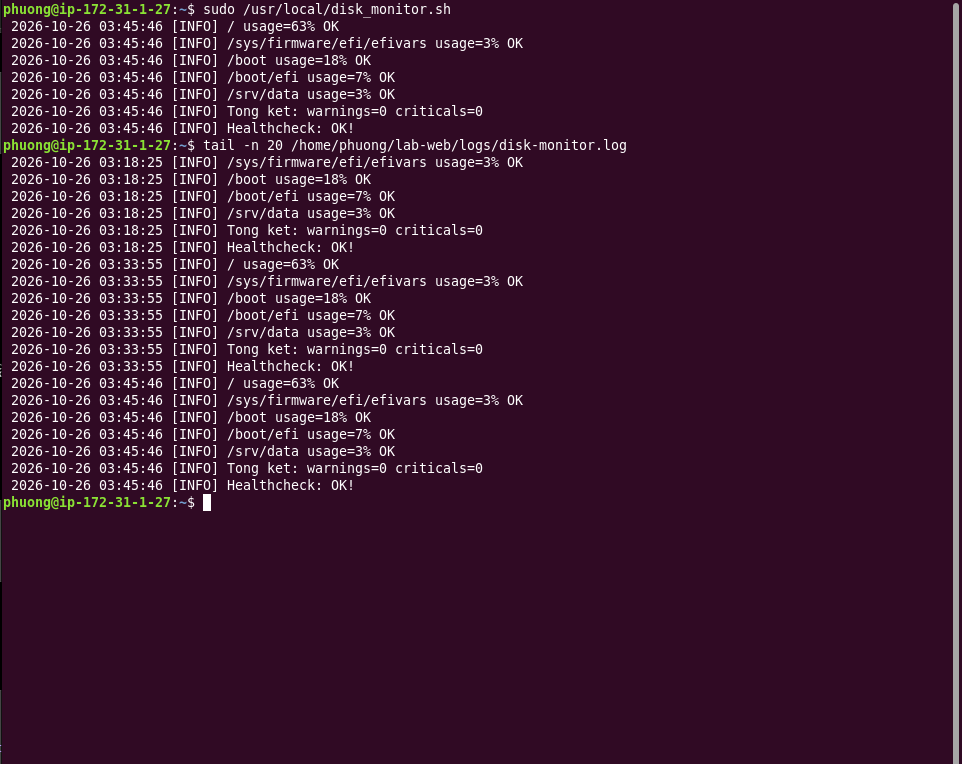

---

## Backup và phục hồi

### `backup.sh`

Chạy tự động mỗi ngày lúc 02:00 qua `backup.timer`. Mỗi lần chạy tạo ra 2 file trong `/srv/data/backups/lab-web`:

| File | Nội dung |
|---|---|
| `src-YYYYMMDD-HHMMSS.tar.gz` | Source code, cấu hình Nginx, PHP, MariaDB và `docker-compose.yml` |
| `db-YYYYMMDD-HHMMSS.sql.gz` | Toàn bộ database dump (single-transaction, gồm routines và triggers) |

- Các file cũ hơn ngưỡng retention sẽ bị xóa tự động.
- File dump được kiểm tra bằng `gzip -t` trước khi đổi tên chính thức. Nếu dump lỗi, file `.tmp` không được đổi tên và lần chạy đó báo thất bại rõ ràng.

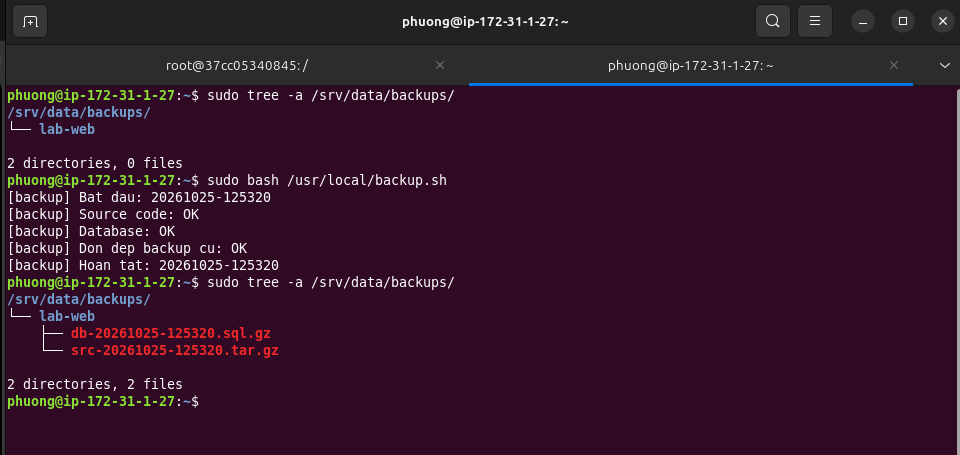

### `recovery.sh`

Phục hồi database từ một file backup, yêu cầu xác nhận thủ công trước khi thực hiện:

```bash
sudo ./scripts/recovery.sh db-20241025-020001.sql.gz
```

Script thực hiện theo thứ tự:

1. Kiểm tra file backup tồn tại và là file gzip hợp lệ.
2. Đọc thông tin đăng nhập database từ file `.env` của dự án.
3. Hiển thị thông tin backup và yêu cầu gõ `RESTORE` để xác nhận.
4. Giải nén và pipe SQL trực tiếp vào container MariaDB đang chạy.

### Demo phục hồi

**Bước 1.** Xóa bảng để mô phỏng sự cố mất dữ liệu:

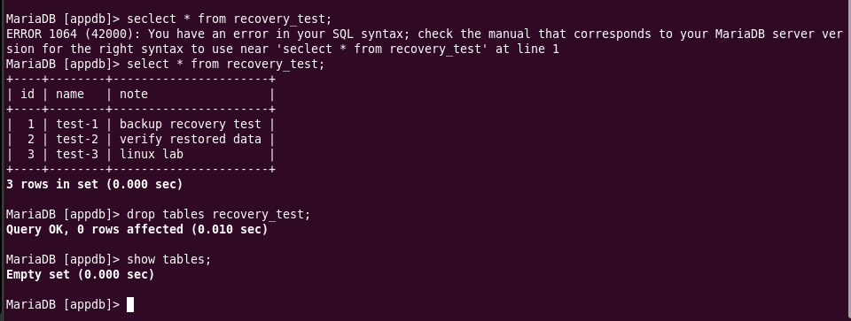

**Bước 2.** Chạy `recovery.sh` với file backup gần nhất:

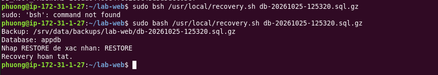

**Bước 3.** Kiểm tra lại database, dữ liệu đã được khôi phục:

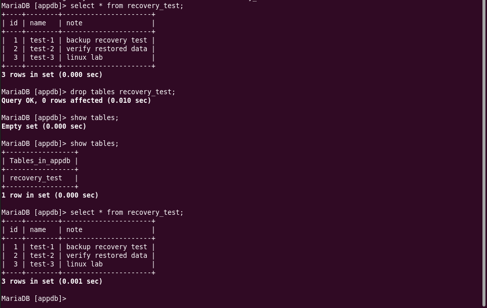

---

## Hướng dẫn triển khai

### Yêu cầu

- EC2 Ubuntu 22.04
- Docker và Docker Compose v2 đã được cài
- AWS Security Group đã mở cổng 80 (và 22 cho SSH)

### Bước 1. Clone repository

```bash
git clone <repo-url> ~/lab-web
cd ~/lab-web
```

### Bước 2. Tạo file biến môi trường

```bash
cp .env.example .env
nano .env
```

Điền các giá trị:

```env
DB_ROOT_PASSWORD=mat_khau_root
DB_DATABASE=labdb
DB_USER=labuser
DB_PASSWORD=mat_khau_user
```

> Không commit file `.env` lên Git.

### Bước 3. Khởi động Docker stack

```bash
docker compose --env-file .env -f docker/docker-compose.yml up -d
```

Kiểm tra các container:

```bash
docker compose --env-file .env -f docker/docker-compose.yml ps
```

### Bước 4. Cài đặt các script giám sát

```bash
sudo cp scripts/backup.sh             /usr/local/bin/backup.sh
sudo cp scripts/server_healthcheck.sh /usr/local/bin/server_healthcheck.sh
sudo cp scripts/disk_monitor.sh       /usr/local/bin/disk_monitor.sh
sudo chmod +x /usr/local/bin/backup.sh \
              /usr/local/bin/server_healthcheck.sh \
              /usr/local/bin/disk_monitor.sh
```

### Bước 5. Cài đặt file cấu hình giám sát

```bash
sudo cp config/lab-web-monitor.conf /etc/lab-web-monitor.conf
sudo nano /etc/lab-web-monitor.conf   # chỉnh đường dẫn cho phù hợp
```

### Bước 6. Cài đặt và kích hoạt Systemd timer

```bash
sudo cp systemd/*.service systemd/*.timer /etc/systemd/system/
sudo systemctl daemon-reload
sudo systemctl enable --now backup.timer
sudo systemctl enable --now server-healthcheck.timer
sudo systemctl enable --now disk-monitor.timer
```

---

## Tham chiếu cấu hình

### `/etc/lab-web-monitor.conf`

```bash
PROJECT_DIR="/home/phuong/lab-web"
COMPOSE_FILE="/home/phuong/lab-web/docker/docker-compose.yml"
HTTP_URL="http://localhost"
DISK_WARN=80
DISK_CRIT=90
```

| Biến | Mô tả | Ví dụ |
|---|---|---|
| `PROJECT_DIR` | Thư mục gốc của dự án trên host | `/home/phuong/lab-web` |
| `COMPOSE_FILE` | Đường dẫn tới `docker-compose.yml` | `/home/phuong/lab-web/docker/docker-compose.yml` |
| `HTTP_URL` | URL dùng cho HTTP health check | `http://localhost` |
| `DISK_WARN` | Ngưỡng % disk để cảnh báo | `80` |
| `DISK_CRIT` | Ngưỡng % disk để báo lỗi nghiêm trọng | `90` |
